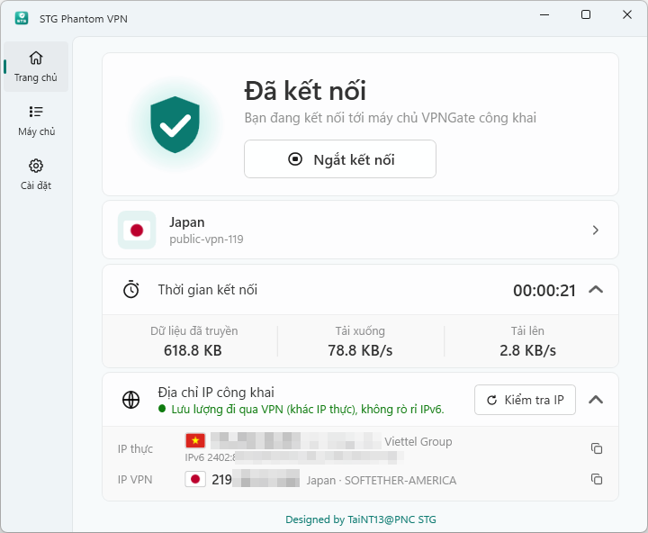

**English** | [Tiếng Việt](README.vi.md)

# STG Phantom VPN for Windows - 1.0.11

A free VPN app for Windows that connects you to VPN Gate's public servers in just a few clicks. Its simple, clear interface makes it a lightweight alternative to the official SoftEther VPN Client.

## Highlights

- Automatically updated VPN Gate server list with country flags; connect or switch servers with a single click.
- Installs the components it needs on first use, with no manual configuration.
- Shows your real IP and VPN IP so you can check the connection; blocks IPv6 leaks and lets you choose your own DNS.
- Windows 11 (Fluent) style interface: Mica background on Windows 11, follows the system light/dark mode.
- Runs in the background from the system tray; the VPN stays connected when the window is closed.
- Interface in Tiếng Việt, English, 简体中文 and ភាសាខ្មែរ.

## System requirements

- Windows 10 or 11 (x64, x86, ARM64); Windows 8.1 and Windows 7 SP1 need a few extra updates, which the app checks for and explains.
- .NET Framework 4.8 (built into Windows 10 1903 and later).
- An Internet connection. On first use the app downloads the official OpenVPN and the TAP-Windows6 virtual network driver; this step asks once for administrator permission (UAC).

## Installation

1. Download `STGPhantomVPN-Setup-1.0.11.exe` (recommended) or the portable `STGPhantomVPN-Windows-1.0.11.zip`.
2. Run the installer and follow the steps. For the portable version, extract the whole folder and run `STGPhantomVPN.exe`.
3. The app is not code-signed yet, so Windows SmartScreen may warn you. Compare the SHA-256 with the accompanying `.sha256` file, then choose **More info → Run anyway**.

## Usage

1. Open the app and wait for the server list to load.
2. Click **Connect** to use the recommended server, or pick another server from the list.
3. The first time, agree to install OpenVPN and the driver when asked.
4. Once connected, the home page shows the VPN IP for confirmation. Click **Disconnect** to stop.

## Notes

- The app has no kill switch yet: if the VPN tunnel drops, traffic goes over the normal connection.
- VPN Gate servers are run by volunteers, so speed and stability vary.

## Credits

- [VPN Gate](https://www.vpngate.net/) – the University of Tsukuba's public VPN server project, running on [SoftEther VPN](https://www.softether.org/) (open source, Apache 2.0 licence).
- [OpenVPN](https://openvpn.net/) – installed from the official, unmodified installer. "OpenVPN" is a registered trademark of OpenVPN Inc.
- Licence information for third-party components: `licenses/THIRD-PARTY-NOTICES.txt` and `licenses/SOURCE-OFFER.txt`.

Building from source: see [BUILDING.md](BUILDING.md).

STG Phantom VPN is an independent project, not affiliated with SoftEther VPN, VPN Gate or OpenVPN Inc.

Designed by TaiNT13@PNC STG
